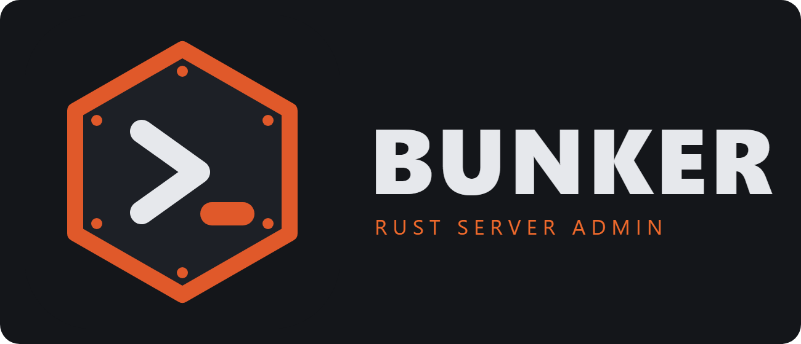
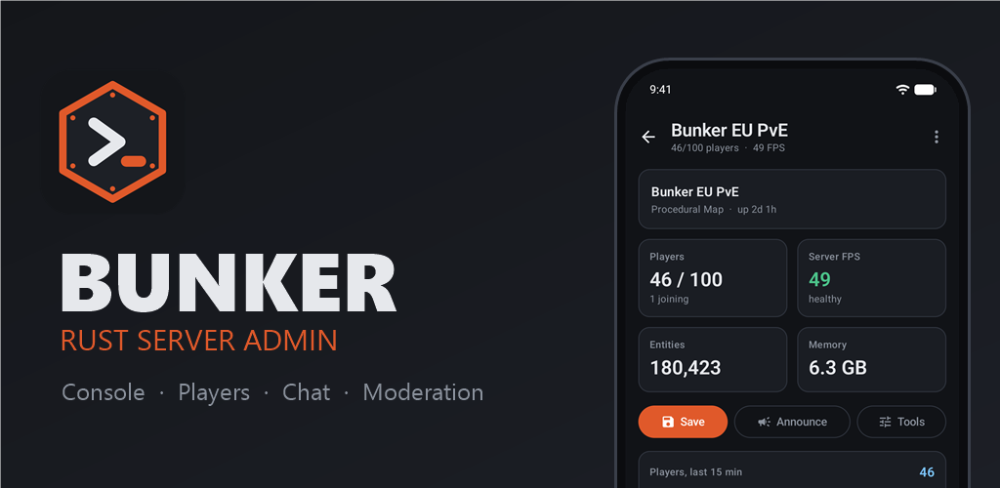
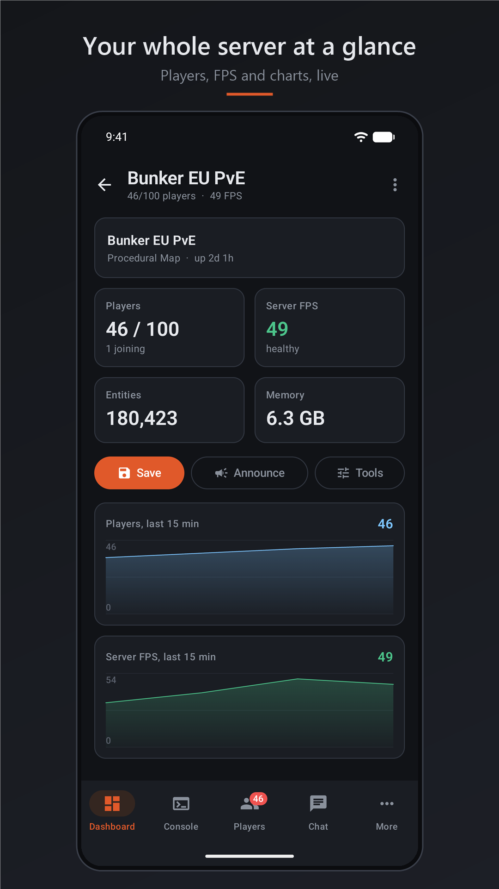
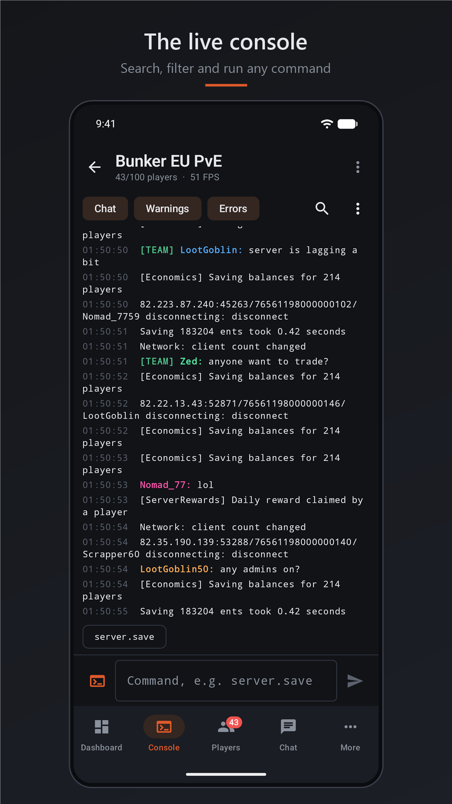
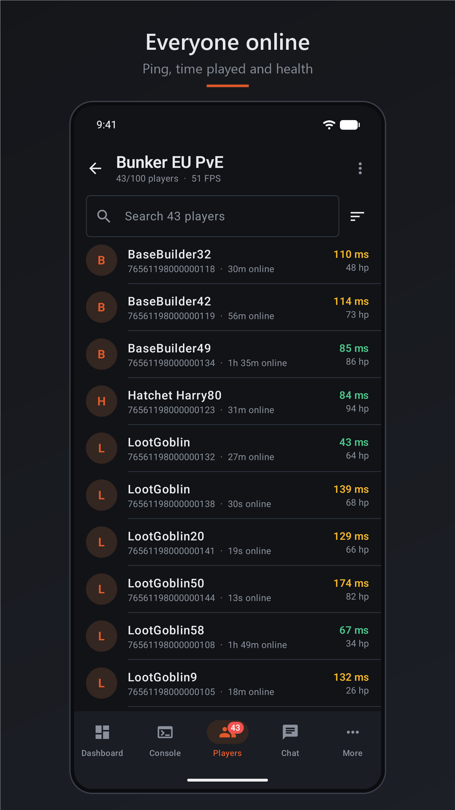
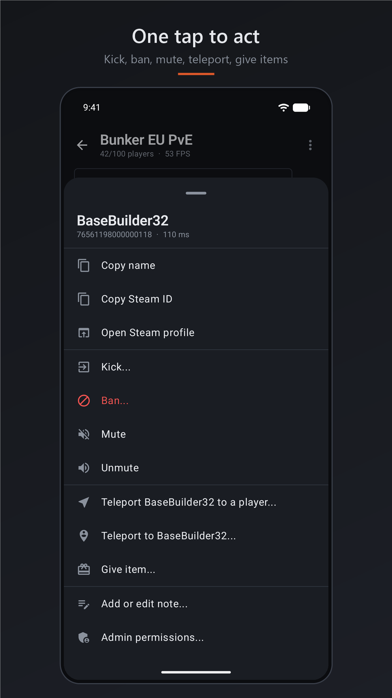
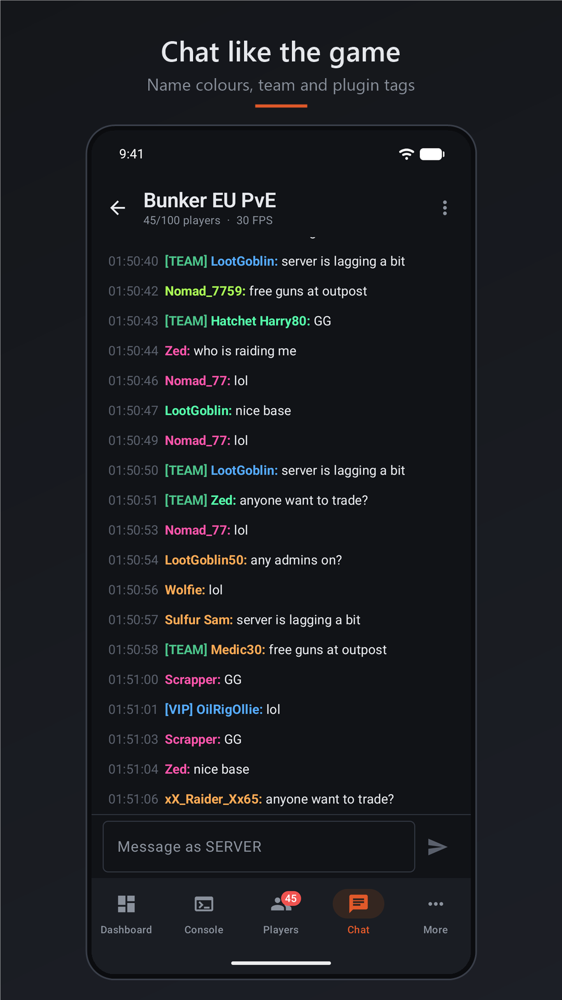
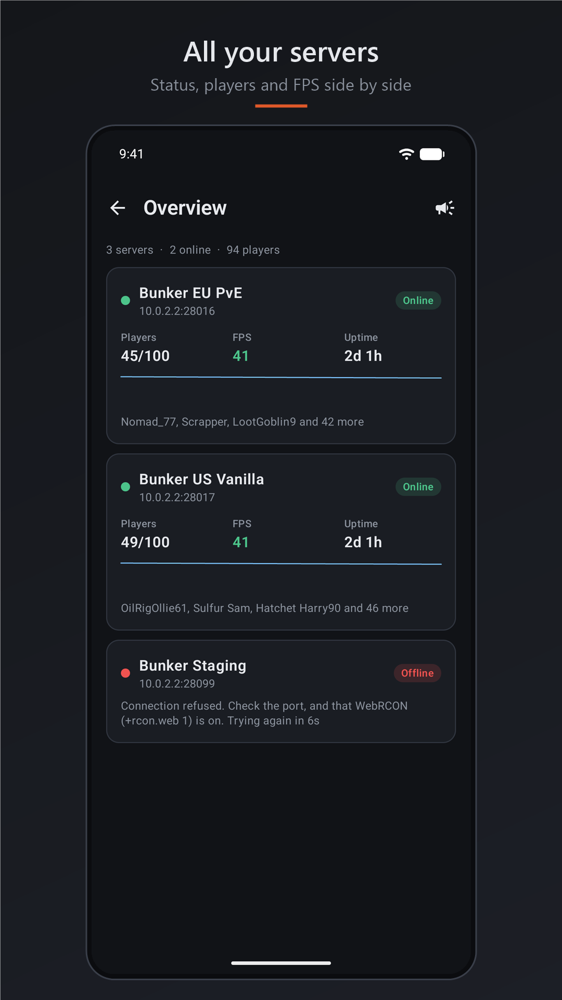
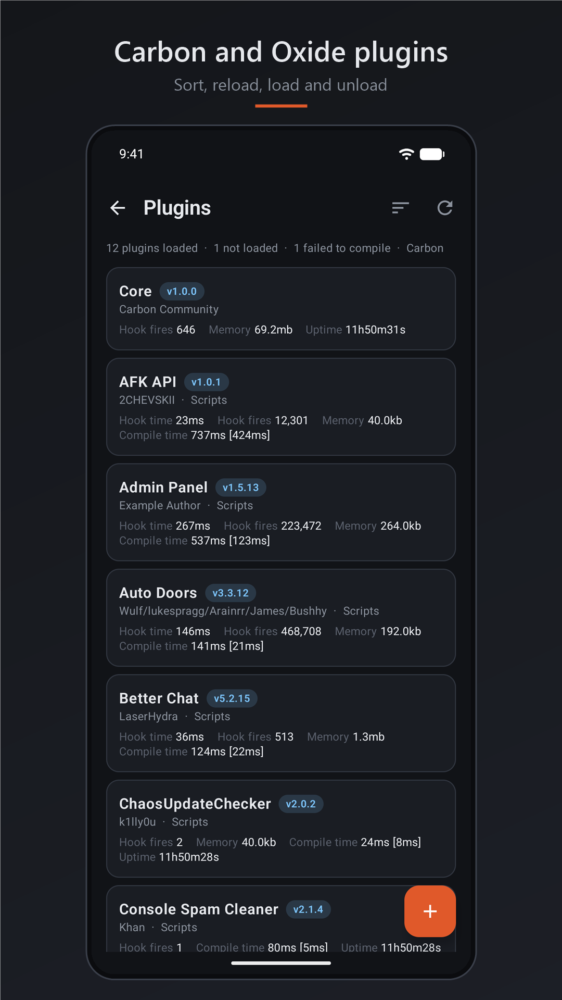
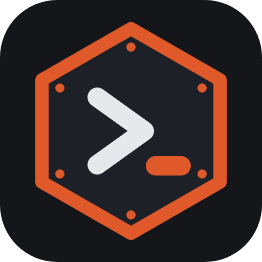

<div align="center">



### 📱 The Android admin console for your **Rust** server
Watch the console, see who's online and run your server from your phone, without ever launching the game.

<br>

[](#-get-it)
[](#-get-it)
[](https://github.com/Russ773/Bunker-Android/actions)
[](https://kotlinlang.org/)
[](https://developer.android.com/compose)

[](#-getting-started)
[](#-getting-started)
[](#-features)
[](#-screenshots)
[](#-safety--privacy)


<br>

**[🌐 getbunker.app](https://getbunker.app)** &nbsp;·&nbsp; **[📲 Get it](#-get-it)** &nbsp;·&nbsp; **[✨ Features](#-features)** &nbsp;·&nbsp; **[🖼️ Screenshots](#-screenshots)** &nbsp;·&nbsp; **[🚀 Getting started](#-getting-started)** &nbsp;·&nbsp; **[🔒 Privacy](#-safety--privacy)** &nbsp;·&nbsp; **[🛠️ Build](#-build-from-source)** &nbsp;·&nbsp; **[🗺️ Roadmap](#-roadmap)**

</div>

<br>



---

## 📲 Get it

<div align="center">

[](#-get-it)

</div>

Bunker for Android is in testing and is **coming to Google Play**. Until then:

1. Build the app yourself (it takes a couple of minutes, see [Build from source](#-build-from-source)), or ask for a test build.
2. Open the `.apk` on your phone and allow *install unknown apps* for the app you opened it from.
3. Start **Bunker** and enter your server's RCON details. That's it.

> 💻 On a PC? **[Bunker for Windows](https://github.com/Russ773/Bunker-Windows)** is the same console as a desktop app, with widgets, a layout designer and a Microsoft Store listing.

---

## ✨ Features

Everything you do most, one thumb away. The Android app follows the Windows app command for command, so the two always agree.

### 🏠 The five tabs

| | |
| --- | --- |
| 📊 **Dashboard** | Players, server FPS, entities, memory, uptime and map at a glance, with live player and FPS charts, one-tap *Save*, *Announce* and *Tools*, your own shortcut buttons, who is online and the latest joins and leaves. |
| 🖥️ **Console** | Live, colour-coded output with command history, search, Chat / Warning / Error filters, and **hiding a whole plugin** (say, everything tagged `[Economics]`) or any words you choose. Tap a line to copy it or hide its plugin, long-press to copy, share the log. A **Command / Chat** switch lets you talk from the same box and asks "say this in chat?" before it sends ordinary words as a command. |
| 👥 **Players** | Everyone online with ping, time played and health. Search, sort, pull to refresh. Tap a player for **copy name or Steam ID, open their Steam profile, kick, ban, mute, unmute, teleport them to someone (or someone to them), give an item with a searchable list and pictures, a private note, and admin permissions**. |
| 💬 **Chat** | Chat the way the game shows it: coloured player names, a green **[TEAM]** tag, plugin prefixes such as **[VIP]**, watch-words highlighted, and a box to talk back **as yourself** (your name, colour and Steam picture, through the small [BunkerChat plugin](app/src/main/assets/BunkerChat.cs)) or as SERVER. |
| ⋯ **More** | Everything else below. |

### 🧰 More

| | |
| --- | --- |
| 🌐 **Multi Server** | Every saved server on one page: online or offline (and **why**), players, FPS, uptime, a player sparkline and who is on. Tap one to open it, or **say something or run a command on all online servers** in one go (you confirm first). The extra connections only exist while the page is open. |
| 🧩 **Plugins** | Carbon and Oxide plugin lists as **sortable cards** (versions, hook time, memory, uptime), with **reload, load and unload**, unloaded plugins and compile failures listed. Tested against a real Carbon reply. |
| ⚡ **Quick actions** | Save the world, set the time of day, shut down with a countdown (with a confirmation: Rust's restart can't be cancelled). |
| 📣 **Announce** | Message everyone, with saved messages for reuse. |
| 📈 **Server health** | Charts of players, FPS, entities and memory over 5 minutes to 2 hours. Spot lag spikes and restarts. |
| ⏰ **Scheduler** | Recurring announcements, a daily world save, restart warning sequences with `wait` steps. Runs while Bunker is connected. |
| 🔘 **Shortcuts** | Your own buttons for any console command, with an optional "ask first". |
| 🗂️ **Player database** | Everyone Bunker has seen, with **your own notes**, time played and sessions, a live join / leave feed and **CSV export**. Tap anyone for the full player menu, even if they have left. |
| 🚫 **Ban list** | Who is banned and until when, search, **unban**, or ban a Steam ID. |
| 🎁 **Give items** | Search every current Rust item with its picture and give it to a player or everyone. The list comes from the game's own files and updates itself when Rust does. |

### 📱 Made for a phone

* 🔌 **Stays connected** with the screen off (a quiet notification keeps Android from closing it), and **auto-reconnects** if the connection drops: a restart, a wobble, a tunnel.
* 🔔 **Alerts** when the connection is lost, when chat contains one of your watch-words, or (optionally) when someone joins. They only appear when Bunker is in the background.
* 🔋 **Gentle on the battery.** Polling slows down while the app is out of sight.
* 🔐 **App lock** with your fingerprint, face or screen lock, and a switch to hide Bunker from recent apps and block screenshots.
* 🎨 Dark and light themes (or follow the phone), adjustable console text size, keep-screen-on.

---

## 🖼️ Screenshots

<div align="center">
<table>
  <tr>
    <td width="25%"></td>
    <td width="25%"></td>
    <td width="25%"></td>
    <td width="25%"></td>
  </tr>
  <tr>
    <td><sub><b>📊 Dashboard</b>: live numbers and charts</sub></td>
    <td><sub><b>🖥️ Console</b>: search, filters, history</sub></td>
    <td><sub><b>👥 Players</b>: ping, time, health</sub></td>
    <td><sub><b>⚡ One tap to act</b>: kick, ban, give…</sub></td>
  </tr>
  <tr>
    <td></td>
    <td></td>
    <td></td>
    <td></td>
  </tr>
  <tr>
    <td><sub><b>💬 Chat</b>: colours, [TEAM] and tags</sub></td>
    <td><sub><b>🌐 Multi Server</b>: every server at once</sub></td>
    <td><sub><b>🧩 Plugins</b>: Carbon and Oxide</sub></td>
    <td></td>
  </tr>
</table>
</div>

> The servers and players in these pictures are made up (they come from the [test server](#-try-it-without-a-rust-server) in `tools/`).

---

## 🚀 Getting started

### 1. Turn on WebRCON on your Rust server

Add these to your server's startup parameters, then restart it:

```text
+rcon.web 1 +rcon.port 28016 +rcon.password "choose-a-strong-password"
```

Make sure the RCON port (`28016` here) is reachable from your phone. On a hosted server that usually means opening it in the control panel. Away from home it has to be reachable from the internet, so use a strong password.

### 2. Connect

Start Bunker. The welcome screen asks for:

| Field | Example |
| --- | --- |
| Server name | `My Rust Server` (optional) |
| Server address | `123.45.67.89` or `play.example.com` (`address:port` works too) |
| RCON port | `28016` |
| RCON password | the one you set above |

Press **Test connection** (Bunker checks it and tells you what's wrong in plain words), then **Save and connect**.

### 3. Optional: chat as yourself

To send chat with your own name and Steam picture, open **Settings → Chat as yourself**, set a name, and use **Copy plugin code** or **Share file** to put **BunkerChat.cs** in your server's `carbon/plugins` (Carbon) or `oxide/plugins` (Oxide) folder. It adds one admin-only command, `bunker.say`. Bunker works fine without it.

---

## 🔒 Safety & privacy

* 🔐 **RCON passwords are encrypted** with a key held in the Android Keystore. It never leaves the phone.
* 🚫 **No accounts, no analytics, no ads, no tracking.** Nothing is backed up to the cloud or transferred to a new phone.
* 📡 Bunker talks to **your server** and to **GitHub** (to fetch the Rust item list and pictures from [bobosneefdev/rust-items-json](https://github.com/bobosneefdev/rust-items-json), at most once a day, switchable off in Settings). Nothing else.
* 🧼 What you type into commands has its quotes and control characters removed first, so a name or a reason can't break out of its command.
* ✋ **Risky things ask first**: restarts, running a command on all servers, giving items to everyone, unloading a plugin.
* 🧪 The command, chat, filter, plugin-table and schedule rules have **automated tests** that run on every push.

Read the full [privacy policy](https://getbunker.app/privacy.html). Plain `ws://` is what Rust's WebRCON speaks, so the traffic to your server is not encrypted. Use a strong password and, where you can, a VPN or a TLS proxy (Bunker supports `wss://` for that).

---

## 📟 Rust commands Bunker uses

| Feature | Commands |
| --- | --- |
| Live data | `serverinfo`, `playerlist` |
| Chat & announcements | `say`, and `bunker.say` (from the optional [BunkerChat plugin](app/src/main/assets/BunkerChat.cs)) |
| Quick actions | `server.save`, `env.time`, `restart` |
| Moderation | `kick`, `banid`, `unban`, `banlistex`, `mute`, `unmute`, `server.writecfg` |
| Permissions | `moderatorid`, `removemoderator`, `ownerid`, `removeowner` |
| Teleport | `teleport` |
| Give items | `inventory.giveto`, `inventory.giveall` |
| Plugins | Carbon: `c.plugins`, `c.reload`, `c.load`, `c.unload` · Oxide: `oxide.plugins`, `oxide.reload`, `oxide.load`, `oxide.unload` |

> ℹ️ Command syntax follows the Windows app and public Rust admin references, and can differ between server versions or plugins. The server's reply always appears in the console, so you can see exactly what happened.

---

## 🛠️ Build from source

You need [Android Studio](https://developer.android.com/studio) (or the Android SDK) and a JDK 17+.

```bash
git clone https://github.com/Russ773/Bunker-Android.git
cd Bunker-Android

./gradlew :app:installDebug          # build and install on a connected phone or emulator
./gradlew :app:testDebugUnitTest     # run the unit tests
./gradlew :app:assembleRelease       # release APK (debug-signed unless keystore.properties exists)
./gradlew :app:bundleRelease         # the .aab for Google Play
```

> **Gradle crashing with `EXCEPTION_ACCESS_VIOLATION` in `jvm.dll`?** Some JDK builds crash the Gradle daemon in a GC thread on certain CPUs. `gradle.properties` already pins `-XX:+UseSerialGC`, which fixed it here.

### 🧪 Try it without a Rust server

```bash
node tools/mock-rcon-server.js                       # port 28016, password "test"
node tools/mock-rcon-server.js --port 28017 --name "US Vanilla"   # a second server for Multi Server
node tools/mock-rcon-server.js --noplugin            # pretend the BunkerChat plugin is missing
node tools/mock-rcon-server.js --players 40 --joining 1 --fast   # a busy server (handy for screenshots)
```

It answers `serverinfo`, `playerlist`, `banlistex`, a real Carbon plugin list and the common admin commands, sends console noise and chat, and makes players come and go. From the Android emulator the host PC is **`10.0.2.2`**, so add a server with address `10.0.2.2`, port `28016`, password `test`. A wrong password gets the socket closed at once, like Rust does.

<details>
<summary><b>📁 Project layout</b></summary>

```text
Bunker-Android/
├── app/src/main/java/app/getbunker/rcon/
│   ├── rcon/     RconClient (OkHttp WebSocket + request/reply), parsers (server info, players, chat, bans,
│   │             console filters, command guess), PluginList (Carbon / Oxide)
│   ├── core/     ServerSession (connect, reconnect, polling, scheduler, chat), ServerWatcher (Multi Server),
│   │             PlayerTracker, ConsoleLog, ItemCatalog, Notifier, ConnectionService (foreground service)
│   ├── data/     models, SettingsStore (JSON in app storage), SecretBox (Keystore AES-GCM)
│   └── ui/       Jetpack Compose screens: servers, session tabs, player actions, tools, lists, settings, theme
├── app/src/test/ unit tests (parsers, chat, filters, plugin tables, schedules)
├── tools/        mock Rust WebRCON server, store image generator
├── store/        Play Store icon, screenshots and feature graphic, logo sources
└── .github/      CI: tests + release build on every push
```

* One `ServerSession` lives while you are on a server. Screens only observe its flows, so rotating the phone or leaving the app never drops the connection.
* RCON replies are matched to your command by `Identifier`; everything else is console output.

</details>

<details>
<summary><b>🚢 How a release works</b></summary>

See [PLAY_STORE.md](PLAY_STORE.md): create an upload key, `./gradlew :app:bundleRelease`, upload the `.aab`, and fill in the listing, data-safety and foreground-service forms (answers are drafted there). Every push to `main` also runs the same build in GitHub Actions.

</details>

---

## 🗺️ Roadmap

- [x] Dashboard, console, players and chat on a phone
- [x] Kick, ban, mute, teleport, give items, notes, admin permissions
- [x] Quick actions, announcements, shortcuts, scheduler, server health
- [x] Ban list and player database with CSV export
- [x] Auto-reconnect and a background connection with alerts
- [x] Carbon and Oxide plugin tables with reload, load and unload
- [x] Multi Server overview with send-to-all
- [x] App lock, dark and light themes
- [ ] Google Play release
- [ ] Community widgets (as on Windows)
- [ ] iOS version

Have an idea? [Open an issue](https://github.com/Russ773/Bunker-Android/issues).

---

## 🙏 Credits

* **Rust item list and pictures:** [bobosneefdev/rust-items-json](https://github.com/bobosneefdev/rust-items-json), which re-reads the game files whenever Rust updates. The item data and pictures belong to Facepunch Studios; Bunker is not affiliated with or endorsed by them.
* Built with [Jetpack Compose](https://developer.android.com/compose), [OkHttp](https://square.github.io/okhttp/), [Coil](https://coil-kt.github.io/coil/) and [kotlinx.serialization](https://github.com/Kotlin/kotlinx.serialization).

---

## 🤝 Contributing

Pull requests are welcome (under the [MIT License](LICENSE)), and bug reports with the steps to reproduce them. Please run `./gradlew :app:testDebugUnitTest` before you open a PR.

---

<div align="center">

<sub>Website: [getbunker.app](https://getbunker.app) &nbsp;·&nbsp; Also for PC: [Bunker for Windows](https://github.com/Russ773/Bunker-Windows) &nbsp;·&nbsp; Released under the [MIT License](LICENSE).</sub>

<sub>Bunker is an independent community tool. **Rust** is a trademark of Facepunch Studios; Bunker is not affiliated with or endorsed by Facepunch.</sub>

<br>



</div>
